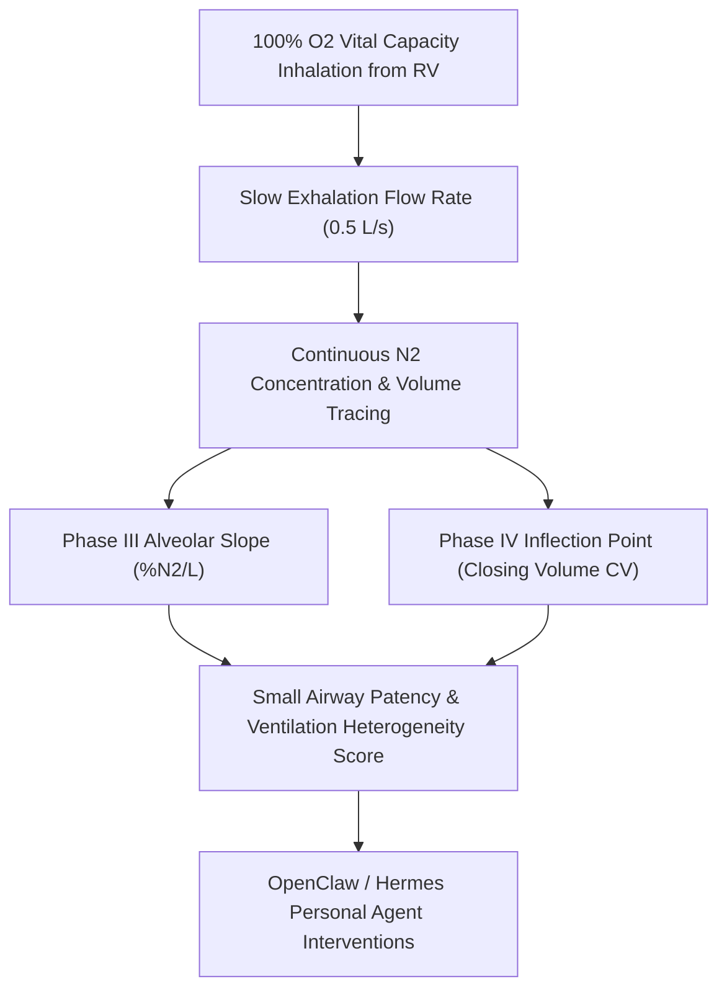

# Pulmonary Closing Volume & Nitrogen Washout (SBN2) Skill

[](LICENSE)
[](https://www.python.org/)
[](requirements.txt)
[](mcp_server.py)
[](SKILL.md)

Zero-dependency sovereign personal agent skill for non-invasive evaluation of Single-Breath Nitrogen Washout (SBN2) Closing Volume (CV), Closing Capacity (CC), and early peripheral small airway closure.



## Features
- **Deterministic Math**: Pure Python standard library implementation with zero external dependencies.
- **Pulmonary Physiology Standards**: Implements validated equations for Closing Volume percentage, Closing Capacity, and age-predicted reference intervals.
- **Small Airway Disease Detection**: Highly sensitive detection of bronchiolar collapse before changes in $FEV_1$ or $FVC$.
- **Model Context Protocol (MCP)**: Native JSON-RPC tool integration for LLMs and autonomous agents.

## Quickstart

```python
from client import PulmonaryClosingVolumeClient

client = PulmonaryClosingVolumeClient()
result = client.evaluate_closing_volume(
    vital_capacity_l=4.8,
    closing_volume_l=0.62,
    residual_volume_l=1.35,
    phase3_slope_pct_n2_per_l=1.1,
    age_years=28
)
print("Closing Volume %:", result["cv_vc_pct"], "%")
print("Small Airway Score:", result["small_airway_score"])
print("Classification:", result["classification"])
```

## License
Apache-2.0
